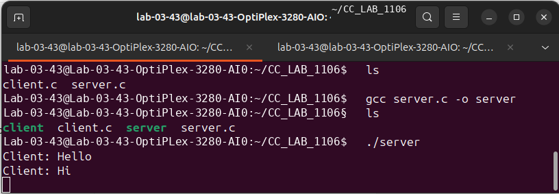

# Practical 2: TCP Echo Server

## Aim
Implement an IPv4 TCP server in C that accepts a client and echoes received bytes.

## Build and run (Linux)
```sh
gcc -Wall -Wextra -pedantic tcp_server.c -o tcp_server
./tcp_server
```
Run the client in Practical 3 in another terminal. Type messages and use `/quit` to disconnect.

## Procedure
Create, bind, and listen on a stream socket at port 8080; accept a client; receive and return bytes until disconnect; close descriptors. The server handles one client at a time.

## Result
Run the programs locally and record your own terminal output for submission.

## Screenshots

### exp02


