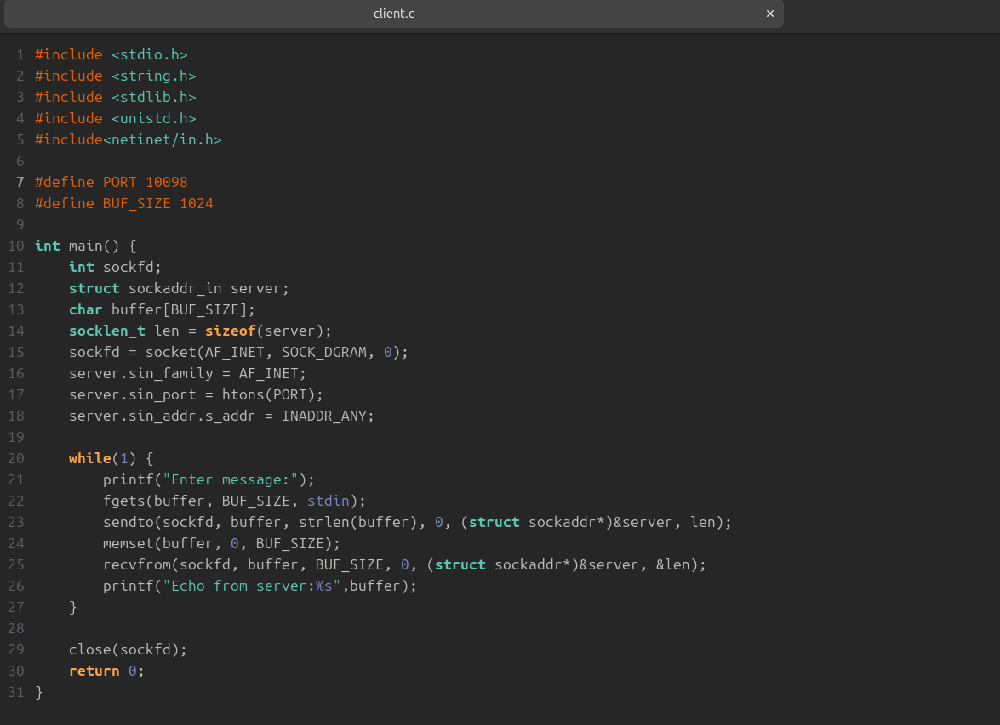
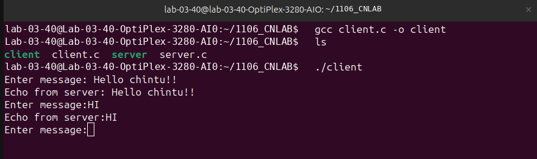

# Practical 4: UDP Echo Client

## Aim
Send a datagram to a UDP echo server and receive its reply.

## Build and run (Linux)
```sh
gcc -Wall -Wextra -pedantic udp_client.c -o udp_client
./udp_client 127.0.0.1 9090
```
Start Practical 5 first. Arguments are server IPv4 address and port (defaults: 127.0.0.1 and 9090).

## Procedure and result
The client sends one line, waits up to five seconds for a datagram, and displays the reply. Test multiple messages and capture your own output. UDP does not guarantee delivery.

## Screenshots

### client code



### client


