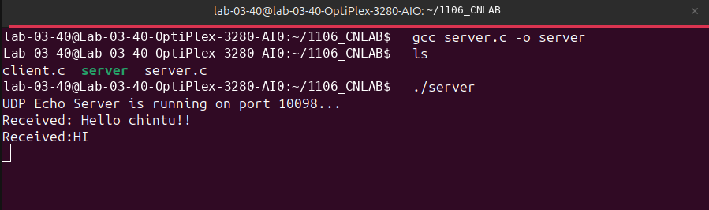
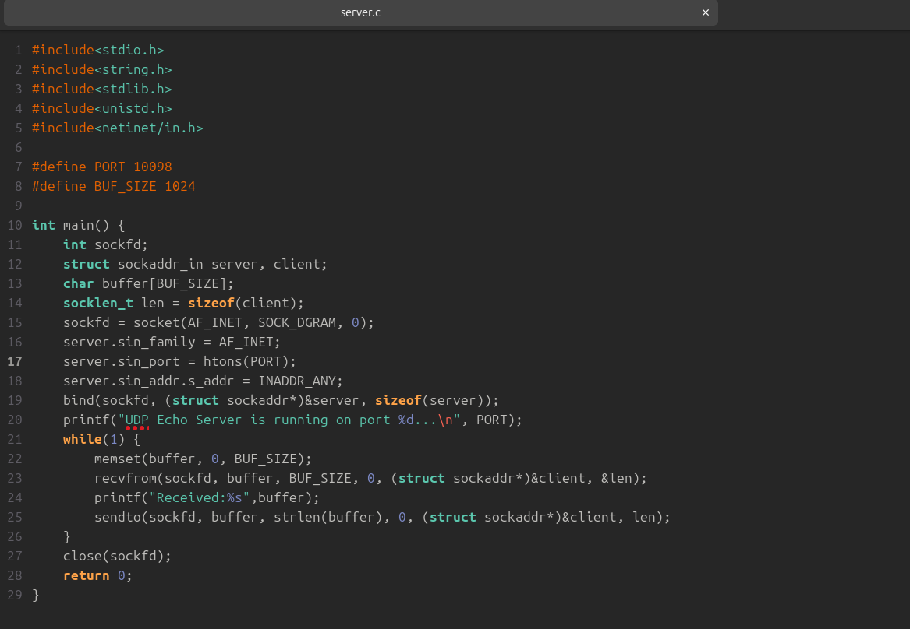

# Practical 5: UDP Echo Server

## Aim
Create a C server that receives datagrams and sends each one back to its sender.

## Build and run (Linux)
```sh
gcc -Wall -Wextra -pedantic udp_server.c -o udp_server
./udp_server
```
Use Practical 4's client from a second terminal.

## Procedure and result
The server binds an IPv4 datagram socket to port 9090, prints the sender address, and returns received bytes. Send several datagrams and record your own terminal output. UDP may lose, reorder, or duplicate packets.

## Screenshots

### exp05



### server code


