# Practical 6: DNS Utilities and Traceroute

## Aim
Inspect DNS records, test reachability, and observe the network route to a destination.

## Suggested exercises
DNS answers and paths vary by network and time. Run these commands yourself.

```sh
nslookup example.com
nslookup -type=NS example.com
nslookup -type=MX gmail.com
ping -c 4 example.com
traceroute example.com
```
With `dig`, try `dig example.com A`, `dig example.com AAAA`, and `dig -x 8.8.8.8`. On Windows, use `ping -n 4 example.com` and `tracert example.com`.

## Record and result
For each command, note its purpose, response type, and one observation from your run. A timeout or filtered hop is a valid observation; do not substitute guessed results. Include your own terminal captures if required.

## Screenshots

### 01 nslookup forward

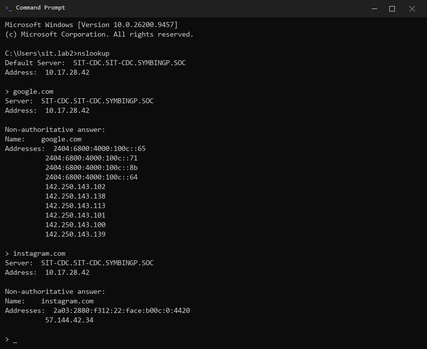

### 02 ping connectivity

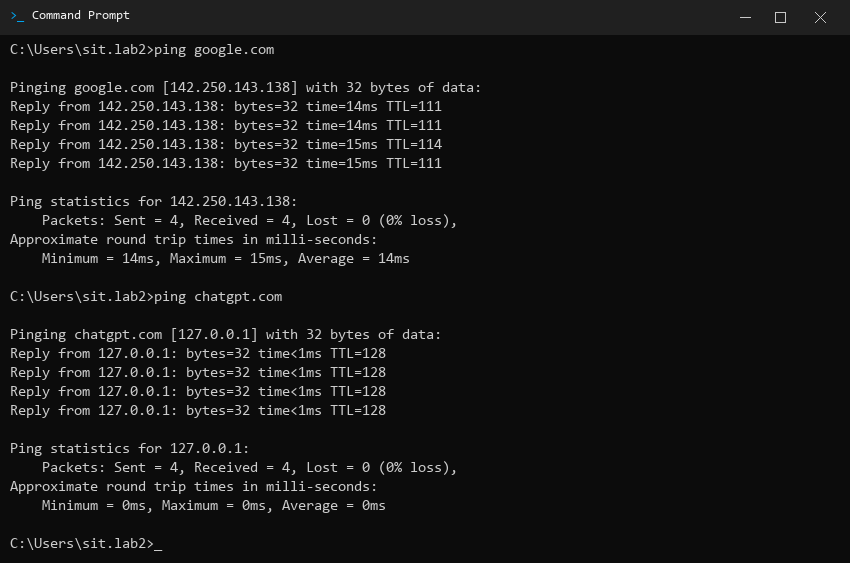

### 03 nslookup ns records

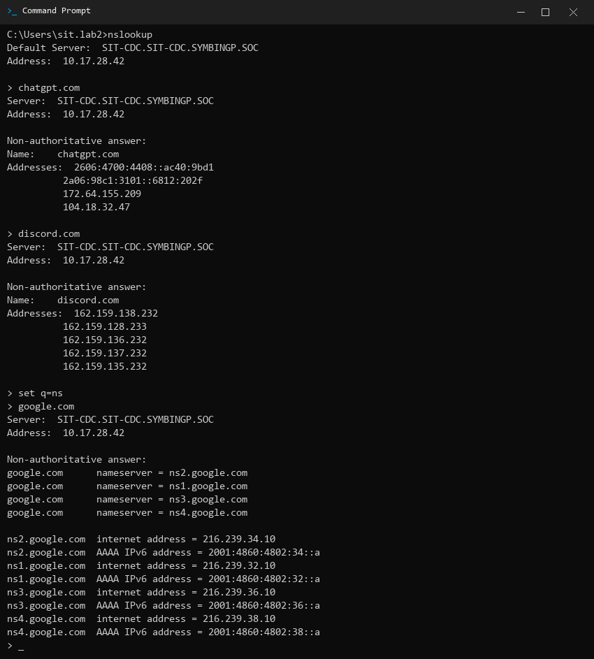

### 04 nslookup cname

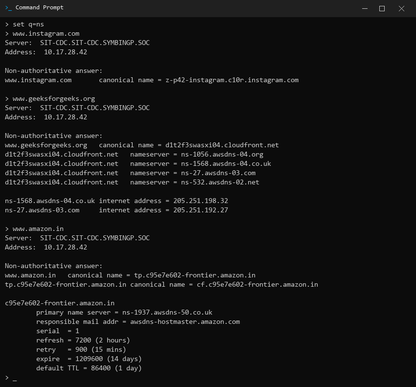

### 05 nslookup soa

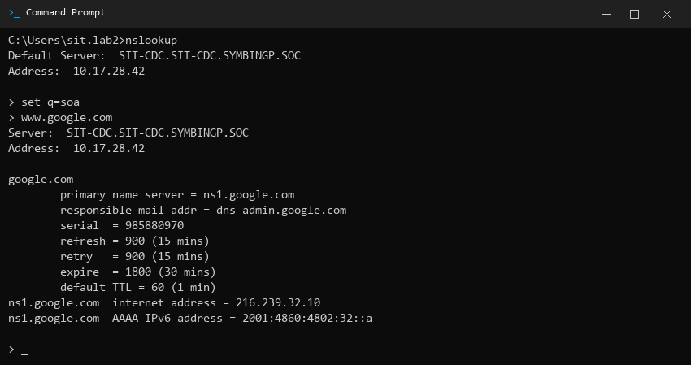

### 06 nslookup debug

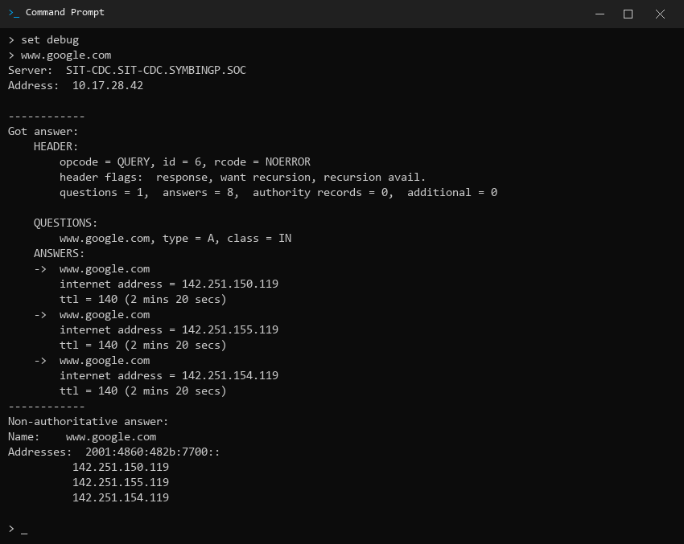

### 07 ipconfig

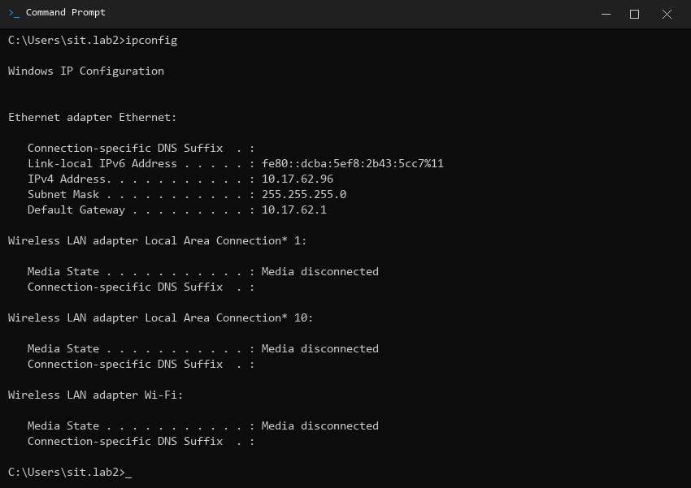

### 08 nslookup mx

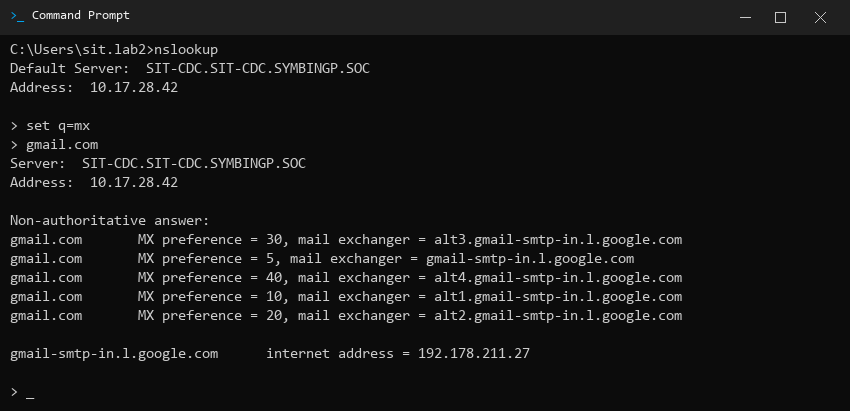

### 09 nslookup reverse

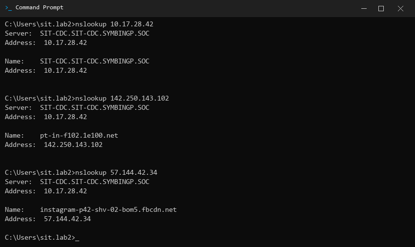

### 10 tracert

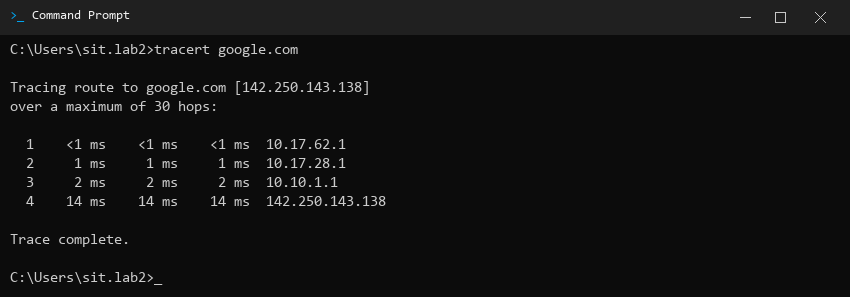

### exp06

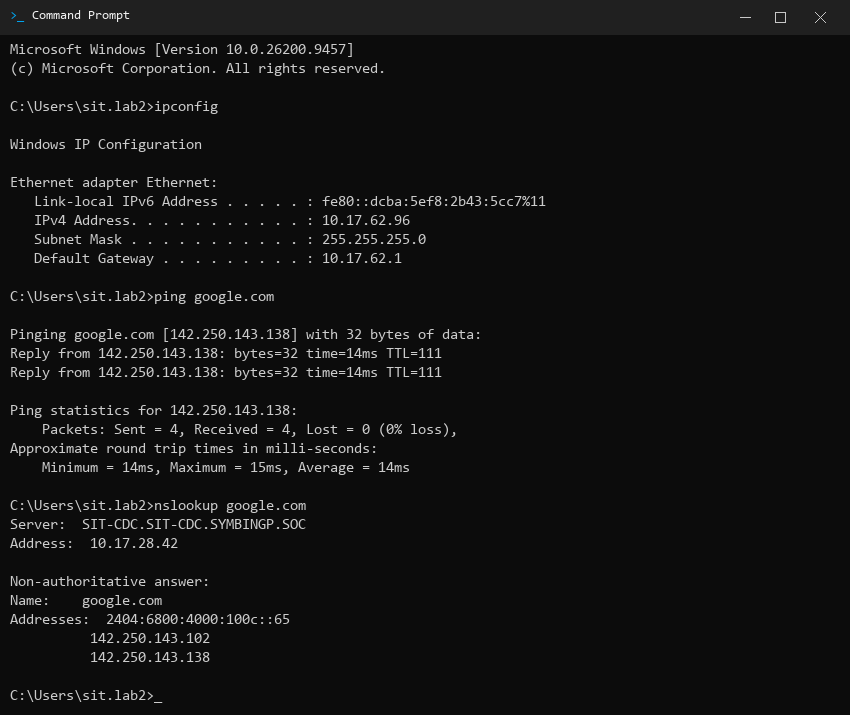
