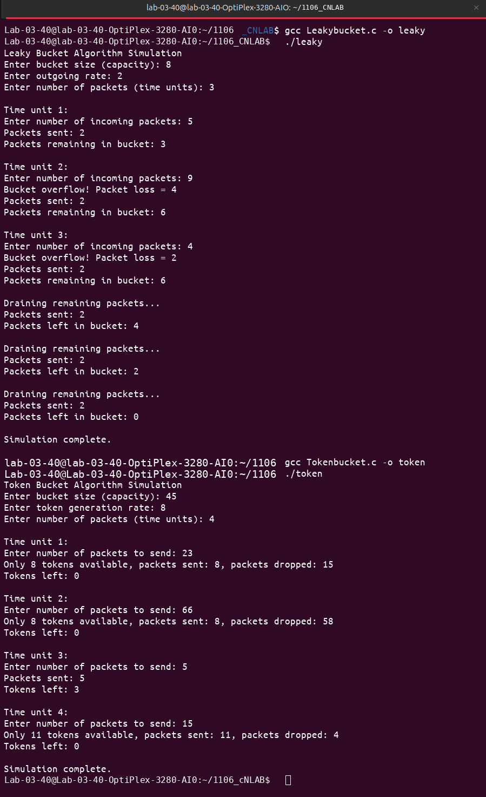
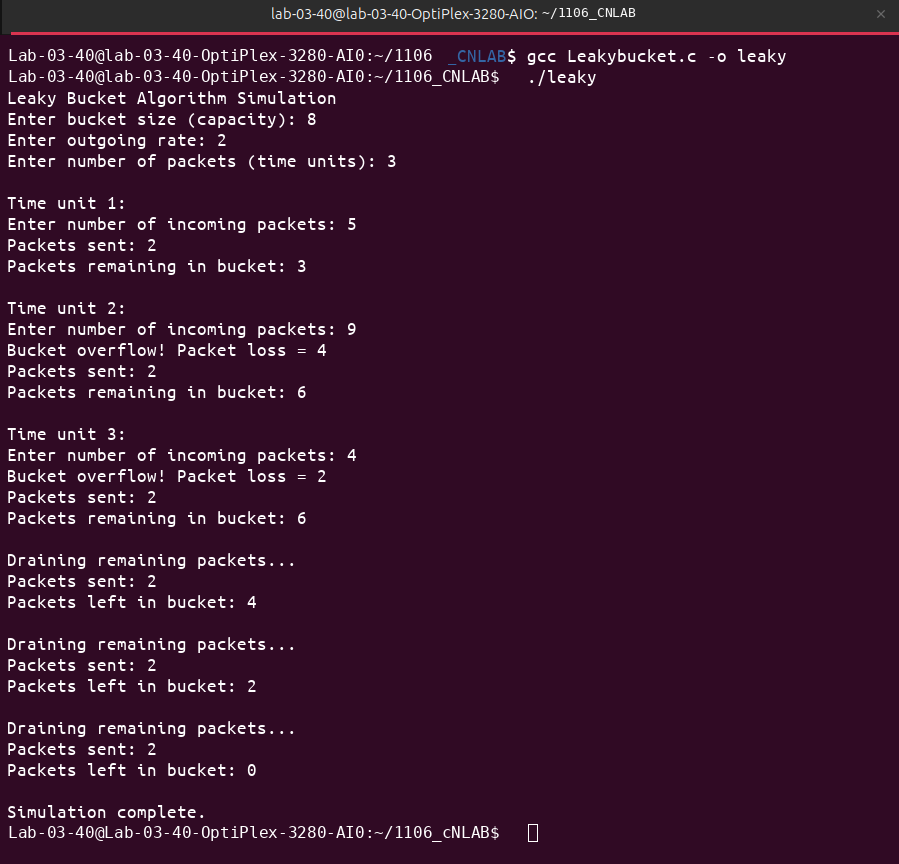
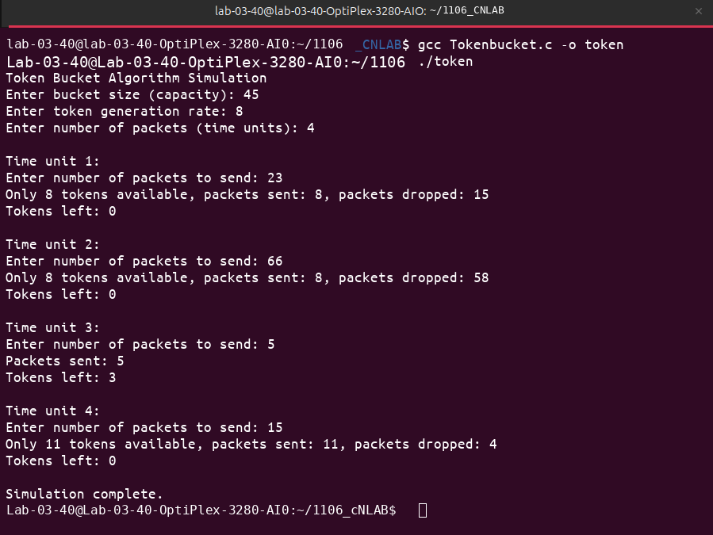

# Practical 9: Traffic Shaping

## Aim
Compare a finite leaky-bucket queue and a token-bucket queue using packet arrivals entered per time slot.

## Build and run (Linux)
```sh
gcc -Wall -Wextra -pedantic traffic_shaping.c -o traffic_shaping
./traffic_shaping
```
Enter queue capacity, token capacity, refill per slot, and nonnegative arrivals for each slot. The discrete model reports transmissions, drops, and tokens/queue remaining. Try steady and bursty traffic, then describe the difference using output from your run.

## Screenshots

### exp09



### leakybucket



### tokenbucket


